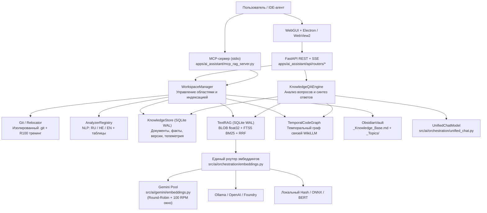
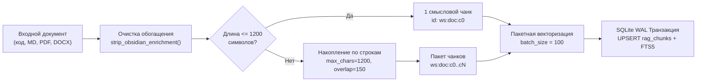
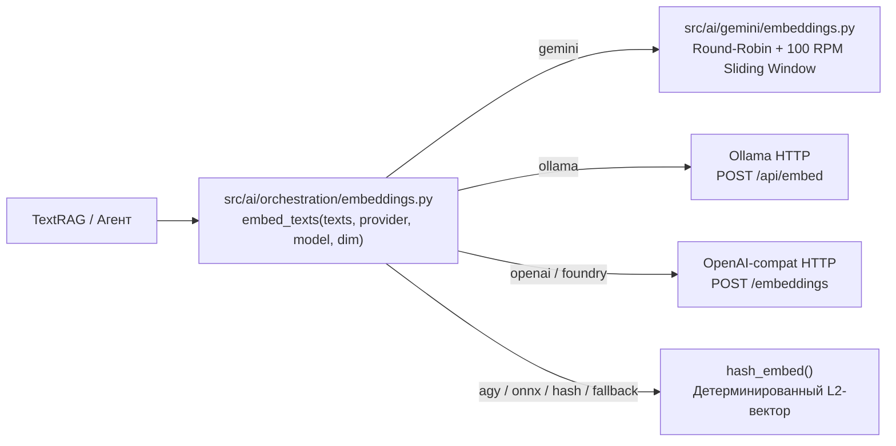
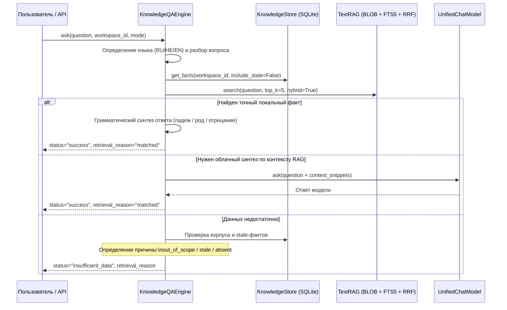
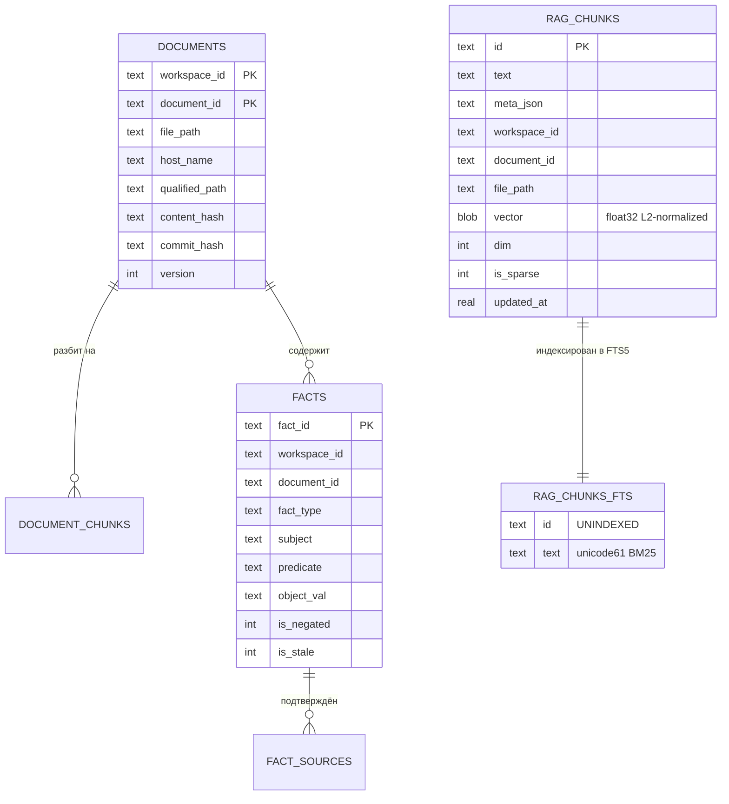

# 📘 Полная техническая документация `apps/ai_assistant`

**Проект:** `ai-windows-admin` (`AI-Assistant`)  
**Версия документации:** 4.0  
**Статус:** ✅ Актуально  
**Язык:** Русский (стандарт `GEMINI.md`)  
**Updated:** 2026-11-23 18:19:00  
**Author:** hypo69  

---

## 📑 Оглавление

1. [Общая архитектура системы](#1-общая-архитектура-системы)
2. [Изолированные рабочие области (Workspaces) и носимый режим](#2-изолированные-рабочие-области-workspaces-и-носимый-режим)
3. [Конвейер индексации и смыслового чанкинга](#3-конвейер-индексации-и-смыслового-чанкинга)
4. [Гибридный RAG-движок: SQLite WAL + BLOB + FTS5 BM25 + RRF](#4-гибридный-rag-движок-sqlite-wal--blob--fts5-bm25--rrf)
5. [Единый маршрутизатор ИИ и эмбеддингов (`src/ai`)](#5-единый-маршрутизатор-ии-и-эмбеддингов-srcai)
6. [Мультиязычный NLP-анализ, QA-движок и статусы свежести](#6-мультиязычный-nlp-анализ-qa-движок-и-статусы-свежести)
7. [Схема баз данных (ER-диаграмма)](#7-схема-баз-данных-er-диаграмма)
8. [Локальный MCP-сервер (`stdio`) для IDE-агентов](#8-локальный-mcp-сервер-stdio-для-ide-агентов)
9. [REST API и WebGUI-оболочка](#9-rest-api-и-webgui-оболочка)
10. [Практические примеры использования (Python, REST, MCP, CLI)](#10-практические-примеры-использования-python-rest-mcp-cli)
11. [Тестирование и диагностика](#11-тестирование-и-диагностика)

---

## 1. Общая архитектура системы

**AI-Assistant** (`apps/ai_assistant`) — локально-приоритетная (Local-first) и носимая (USB-portable) платформа для управления знаниями, Git-версионирования файлов, мультиязычного NLP-анализа (`ru`, `he`, `en`), гибридного векторно-лексического поиска на SQLite и маршрутизации запросов к локальным и облачным моделям ИИ.

### Блок-схема верхнего уровня



---

## 2. Изолированные рабочие области (Workspaces) и носимый режим

Каждая рабочая область (`workspace_id`) полностью самодостаточна и хранит все метаданные, индексы и историю внутри собственного каталога:

```text
<workspaces_dir>/<workspace_id>/
├── .git/                           # Изолированный Git-репозиторий рабочей области
├── .workspace/
│   ├── config.json                 # Настройки, язык, внешние источники (WorkspaceRegistry)
│   ├── knowledge.sqlite            # SQLite WAL: документы, чанки, факты, история запросов
│   ├── temporal_graph.sqlite       # Темпоральный граф связей WikiLLM (valid_from / superseded)
│   └── faiss_indices/
│       └── ws_<workspace_id>.sqlite # Гибридный SQLite RAG (float32 BLOB + FTS5 BM25)
├── .extracted_snapshots/           # Текстовые слепки внешних файлов (PDF/DOCX/код)
├── _Knowledge_Base.md              # Сводная база знаний Obsidian
└── _Topics/                        # Тематические заметки Obsidian Vault
```

### Носимый режим (USB-portable)

При индексации внешних файлов без копирования (`copy_to_workspace = False`):
1. В реестр и SQLite сохраняется имя текущего ПК (`host_name`) и квалифицированный путь вида `\\<HOST_NAME>\<Drive>:\<Path>`.
2. При переносе носителя на другой компьютер файлы с прежнего хоста автоматически получают статус `other_host`, не удаляются из индекса и остаются доступными для поиска через `.extracted_snapshots/`.
3. При перемещении или переименовании файла на диске `WorkspaceRelocator` сверяет SHA-256 содержимого и вызывает `rag.rename_prefix(...)` — перепривязывает все векторы в SQLite одной транзакцией **без повторной векторизации**.

---

## 3. Конвейер индексации и смыслового чанкинга

### Алгоритм разбиения на чанки (`WorkspaceManager._build_faiss_chunks`)

Чтобы исключить дробление исходного кода и текстов на бессмысленные фрагменты по точкам (`.`) и одиночным строкам (`"{"`, `"else:"`), индексация использует строково-ориентированный смысловой чанкинг с контекстным перекрытием:

* **Максимальный размер чанка:** $L_{\max} = 1200$ символов.
* **Перекрытие (overlap):** $O = 150$ символов.
* **Шаг при разбиении сверхдлинного фрагмента:** $S = \max(1,\; L_{\max} - O) = 1050$ символов.
* Если длина документа $|T| \le L_{\max}$, создаётся ровно **1 чанк**.
* Для длинных файлов строки накапливаются в буфер до порога $L_{\max}$, после чего хвост длиной до $O$ символов переносится в начало следующего чанка.



> [!TIP]
> При полной перестройке индекса (`WorkspaceManager.rebuild_faiss_index`) все чанки всех документов собираются в единый список и записываются **одним пакетным вызовом** `rag.add_documents(all_chunks)` без лишнего прогона морфологического NLP-анализатора.

---

## 4. Гибридный RAG-движок: SQLite WAL + BLOB + FTS5 BM25 + RRF

Реализован в [`src/ai/rag/text_rag.py`](../../src/ai/rag/text_rag.py). Хранилище работает на нативном SQLite в режиме `WAL` (`PRAGMA journal_mode=WAL; synchronous=NORMAL; busy_timeout=15000;`) и потребляет **0 МБ RAM в простое**.

### 4.1. Бинарное хранение векторов (`float32 BLOB`)

Каждый вектор $\mathbf{v} \in \mathbb{R}^d$ перед записью нормализуется по $L_2$-норме и сериализуется в бинарный массив IEEE-754 `float32`:

$$\hat{\mathbf{v}} = \frac{\mathbf{v}}{\max\left(\|\mathbf{v}\|_2,\; 10^{-12}\right)}, \qquad \text{размер BLOB} = 4 \cdot d \text{ байт}$$

Для $d = 256$ один чанк занимает ровно **$1024$ байта** (1 КБ). Для 50 000 чанков матрица векторов весит всего ~50 МБ на диске.

### 4.2. Адаптер размерностей на лету

Если вектор запроса $\mathbf{q} \in \mathbb{R}^{d_q}$ получен от модели другой размерности, чем сохранённый индекс $d_s$ (например, при переключении `Gemini 256D` $\leftrightarrow$ `Local BERT 384D` $\leftrightarrow$ `Ollama 768D`), применяется адаптация без переиндексации и без падения:

$$\mathbf{q}' = \begin{cases} \mathbf{q}_{[0 : d_s]}, & \text{если } d_q > d_s \text{ (Matryoshka-усечение)} \\ [\mathbf{q},\; \mathbf{0}_{d_s - d_q}], & \text{если } d_q < d_s \text{ (zero-padding)} \\ \mathbf{q}, & \text{если } d_q = d_s \end{cases}, \qquad \hat{\mathbf{q}} = \frac{\mathbf{q}'}{\max\left(\|\mathbf{q}'\|_2,\; 10^{-12}\right)}$$

### 4.3. Семантическое сходство (Dense)

Поскольку и сохранённые векторы $\hat{\mathbf{v}}_i$, и запрос $\hat{\mathbf{q}}$ $L_2$-нормированы, косинусное сходство вычисляется одним матричным произведением в `numpy`:

$$\text{sim}_{\text{vec}}(i) = \max\left(0,\; \hat{\mathbf{v}}_i \cdot \hat{\mathbf{q}}\right)$$

### 4.4. Лексический поиск (SQLite FTS5 Okapi BM25)

Параллельно выполняется полнотекстовый поиск по виртуальной таблице `rag_chunks_fts` (токенизатор `unicode61`) с ранжированием `bm25(rag_chunks_fts)`:

$$\text{BM25}(D, Q) = \sum_{t \in Q} \text{IDF}(t) \cdot \frac{f(t, D) \cdot (k_1 + 1)}{f(t, D) + k_1 \cdot \left(1 - b + b \cdot \frac{|D|}{\text{avgdl}}\right)}$$

### 4.5. Склейка через Reciprocal Rank Fusion (RRF)

Два ранжированных списка — векторный ($\text{rank}_{\text{vec}}$) и лексический ($\text{rank}_{\text{bm25}}$) — объединяются без ручной калибровки масштабов через формулу **RRF** ($k = 60$):

$$\text{RRF}(d) = \frac{1}{k + \text{rank}_{\text{vec}}(d)} + \frac{1}{k + \text{rank}_{\text{bm25}}(d)}, \qquad k = 60$$

Нормированная RRF-оценка и итоговый `score` в диапазоне $[0,\; 1]$:

$$\text{RRF}_{\text{norm}}(d) = \min\left(1.0,\; \frac{\text{RRF}(d)}{\text{RRF}_{\max}}\right), \qquad \text{score}(d) = \begin{cases} 0.65 \cdot \text{sim}_{\text{vec}}(d) + 0.35 \cdot \text{RRF}_{\text{norm}}(d), & \text{если } d \in \text{BM25} \land \text{sim}_{\text{vec}} > 0 \\ 0.50 \cdot \text{RRF}_{\text{norm}}(d), & \text{если } d \in \text{BM25} \land \text{sim}_{\text{vec}} = 0 \\ \text{sim}_{\text{vec}}(d), & \text{иначе} \end{cases}$$

### 4.6. Безопасная SQL-фильтрация Windows-путей (`INSTR` вместо `LIKE`)

В SQLite оператор `LIKE` интерпретирует обратный слэш `\` и символы `%`, `_` как служебные, что ломает фильтрацию путей Windows (`C:\Users\...\Deckor\`). Во всех запросах `TextRAG` и `doc_categorizer.py` используется нативная функция `INSTR`:

```sql
SELECT id, text, meta_json, vector, dim, is_sparse
FROM rag_chunks
WHERE workspace_id = ?
  AND INSTR(LOWER(file_path), LOWER(?)) > 0;
```

---

## 5. Единый маршрутизатор ИИ и эмбеддингов (`src/ai`)

Все потребители (`TextRAG`, `QAEngine`, агенты) работают только через единый уровень оркестрации `src/ai/orchestration/` и **не содержат** логики конкретных провайдеров или управления ключами.

* **Чат / генерация:** [`src/ai/orchestration/unified_chat.py`](../../src/ai/orchestration/unified_chat.py) (`UnifiedChatModel.ask(...)`).
* **Эмбеддинги:** [`src/ai/orchestration/embeddings.py`](../../src/ai/orchestration/embeddings.py) (`embed_texts(...)`).



### 5.1. Инкапсулированная ротация ключей Gemini (`src/ai/gemini/embeddings.py`)

Для каждого ключа $k_j$ в пуле (`src/secrets/gemini_keys.json`) ведётся потокобезопасное скользящее минутное окно $W_j(t)$ отправленных текстов за последние $\Delta T = 60\text{ с}$:

$$U_j(t) = \sum_{(t_i,\, n_i) \in W_j,\; t - t_i < 60} n_i, \qquad A_j(t) = \text{RPM}_{\max} - U_j(t), \qquad \text{RPM}_{\max} = 100$$

1. Выбор ключа идёт по **Round-Robin** начиная с курсора `(_RR_CURSOR % N)`: выбирается первый ключ, у которого $A_j(t) \ge |B|$ (размер текущего пакета текстов) и нет активного `cooldown`.
2. Если все ключи пула одновременно исчерпали минутное окно, вычисляется минимальное время до освобождения квоты $t_{\text{wait}} \le 65\text{ с}$ — выполняется ожидание вместо порчи индекса несовместимыми векторами.
3. При ошибке `429 RPM` ключ получает временный `cooldown` (по `retryDelay` из ответа API) **без 24-часового бана**.
4. При суточном `429` или `401/403` вызывается `mark_exhausted(key_name)` и мгновенная ротация на следующий ключ пула.

---

## 6. Мультиязычный NLP-анализ, QA-движок и статусы свежести

[`KnowledgeQAEngine`](core/qa_engine.py) объединяет локальный морфосинтаксический анализ (`ru`, `he`, `en`), базу фактов SQLite, гибридный поиск `TextRAG` и облачные модели.

### Диаграмма последовательности обработки вопроса (`qa.ask`)



### Типизированные причины результата (`retrieval_reason`)

| Значение `retrieval_reason` | Когда возвращается | Рекомендуемое действие агента / UI |
|---|---|---|
| `matched` | Найден актуальный факт в SQLite или подтверждённый ответ RAG | Показать ответ со ссылками на источники |
| `stale` | В базе есть только устаревшие (`is_stale=1`) факты по запросу | Предупредить об устаревании, запустить переиндексацию |
| `out_of_scope` | В рабочей области нет проиндексированных документов и векторов | Подключить источники / выбрать другую область |
| `absent` | Корпус проиндексирован, но ответа на вопрос в нём нет | Не галлюцинировать; расширить поиск или уточнить вопрос |

---

## 7. Схема баз данных (ER-диаграмма)



---

## 8. Локальный MCP-сервер (`stdio`) для IDE-агентов

Модуль [`apps/ai_assistant/mcp_rag_server.py`](mcp_rag_server.py) реализует локальный **MCP 2.x** сервер (`MCPServer`) поверх стандартных потоков `stdio` (без открытых HTTP-портов) по протоколу **«RAG-навигатор + точечное чтение»**:

1. Вместо дампа гигантских файлов в контекст LLM (что вызывает деградацию *Lost in the Middle*), агент вызывает `mcp_rag_search` и получает компактные координаты (`document_id`, `original_path`, `chunk_index`, `commit_hash`, `bm25_rank`, сниппет до 320 символов).
2. Затем агент точечно вызывает `mcp_read_file_lines` (до 200 строк за запрос) и забирает точный код/формулы.

### Список MCP-инструментов

| Инструмент | Параметры | Назначение |
|---|---|---|
| `mcp_list_workspaces` | — | Список рабочих областей и статус их SQLite-индексов |
| `mcp_workspace_status` | `workspace_id` | Статистика документов, чанков и путь к `.sqlite` |
| `mcp_rag_search` | `query`, `workspace_id`, `top_k`, `document_id`, `path_contains` | Гибридный поиск (Dense BLOB + FTS5 BM25 + RRF) в режиме навигатора |
| `mcp_read_file_lines` | `file_path`, `start_line`, `end_line` | Точечное чтение диапазона строк файла (макс. 200 строк) |

### Подключение в IDE (Antigravity / Claude Code)

```json
{
  "mcpServers": {
    "ai-assistant-local-rag": {
      "command": "py",
      "args": ["apps/ai_assistant/mcp_rag_server.py"],
      "cwd": "C:/Users/onela/AppData/Local/AI-Assistant"
    }
  }
}
```

---

## 9. REST API и WebGUI-оболочка

Веб-сервер FastAPI (`apps/ai_assistant/api/`) объединяет модульные роутеры (`router_knowledge.py`, `router_models.py`, `router_keys.py`, `router_doc_categorizer.py`, `router_git_wikillm.py`, `router_obsidian.py`, `router_tasks.py`, `router_gmail.py`, `router_drive.py`, `router_calendar.py`, `router_contacts.py` и др.).

### Основные конечные точки

| Метод и путь | Описание |
|---|---|
| `GET /api/v1/workspaces` | Список всех рабочих областей |
| `POST /api/v1/workspaces/{ws_id}/import` | Импорт/обновление документа с Git-коммитом, NLP и индексацией |
| `POST /api/v1/workspaces/{ws_id}/sync` | Синхронизация подключённых внешних файлов и директорий |
| `POST /api/v1/workspaces/{ws_id}/rag/rebuild` | Полная пакетная перестройка SQLite RAG-индекса |
| `POST /api/v1/ask` | Вопрос к базе знаний (возвращает `answer`, `status`, `retrieval_reason`, `sources`) |
| `POST /api/v1/ask/stream` | Потоковый SSE-ответ с промежуточными статусами |
| `GET /api/v1/models` | Каталог доступных чат- и эмбеддинг-моделей по провайдерам |

Двухслойный WebGUI (`apps/ai_assistant/api/webgui/` + `apps/common/webgui/`) поддерживает 5 тем оформления, полную локализацию (`ru`, `en`, `he`, `uk`) с SSR-рендерингом токенов `{{key}}` и RTL-режим для иврита.

---

## 10. Практические примеры использования (Python, REST, MCP, CLI)

### Пример 1: Гибридный поиск `TextRAG` с фильтрацией по Windows-пути

```python
from pathlib import Path
from src.ai.rag.text_rag import TextRAG

rag = TextRAG(db_path=Path("data/demo/rag_index"), dimension=256, provider="gemini")

rag.add_documents([
    {
        "id": "ws1:builder.py:c0",
        "text": "NODE_PX = 11\nAXIS_PX = 9\ndef snap_node(x): return round(x / NODE_PX) * NODE_PX",
        "meta": {
            "workspace_id": "ws1",
            "document_id": "builder.py",
            "original_path": r"C:\Users\dev\Projects\Deckor\src\builder.py",
        },
    }
])

# Гибридный поиск (Dense + FTS5 BM25 + RRF) с безопасным INSTR-фильтром пути
hits = rag.search(
    query="константа NODE_PX примагничивание узлов",
    top_k=5,
    workspace_id="ws1",
    path_contains=r"Projects\Deckor\src",
)
for h in hits:
    print(h["id"], h["score"], "BM25 rank:", h["bm25_rank"])
```

### Пример 2: Импорт документа и вопрос через `WorkspaceManager` + `KnowledgeQAEngine`

```python
import asyncio
from apps.ai_assistant.core.workspace_manager import WorkspaceManager
from apps.ai_assistant.core.qa_engine import KnowledgeQAEngine

async def main():
    wm = WorkspaceManager()
    wm.create_or_select_workspace("demo_ws", name="Демо-область")
    wm.import_document(
        workspace_id="demo_ws",
        document_id="notes.md",
        content="Мама мыла раму. Она сделала это утром.",
    )

    qa = KnowledgeQAEngine(workspace_manager=wm)
    res = await qa.ask("Кем была вымыта рама?", workspace_id="demo_ws", mode="local_only")
    print(res["answer"], "| reason:", res["retrieval_reason"])

asyncio.run(main())
```

### Пример 3: Прямой вызов единого роутера эмбеддингов

```python
from src.ai.orchestration.embeddings import embed_texts

# Вся ротация ключей и учёт 100 RPM инкапсулированы внутри провайдера Gemini
vectors = embed_texts(
    texts=["Первый фрагмент", "Второй фрагмент"],
    provider="gemini",
    dimension=256,
)
```

### Пример 4: Запуск из CLI (PowerShell)

```powershell
# Полный запуск приложения (сервер + десктопное окно)
py -m apps.ai_assistant.main

# Только веб-сервер (headless) на порту 8095
py -m apps.ai_assistant.main --no-gui --port 8095

# Запуск локального MCP-сервера (stdio)
py apps/ai_assistant/mcp_rag_server.py
```

---

## 11. Тестирование и диагностика

```powershell
# Тесты гибридного RAG, ротации ключей Gemini, адаптера размерностей и MCP-сервера
pytest src/ai/rag/tests/test_unified_rag.py -v

# Тесты рабочих областей, мультиязычного QA, API моделей и оптимизаций
pytest apps/ai_assistant/tests/test_multilingual_knowledge_qa.py `
       apps/ai_assistant/tests/test_workspace_registry.py `
       apps/ai_assistant/tests/test_models_tab_and_api.py `
       apps/ai_assistant/tests/test_optimizations_and_coreference.py -v

# Полный прогон всех тестов приложения
pytest apps/ai_assistant/tests -v
```
